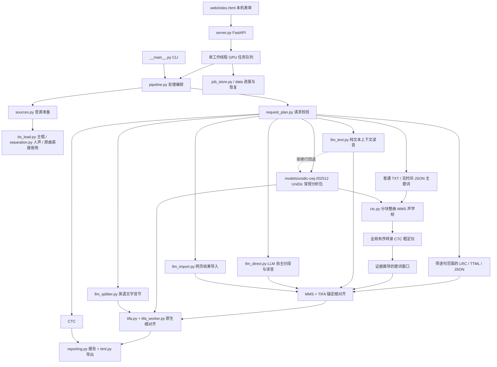

# 架构与维护边界

## 实际运行链路



`auto` 与显式 `tifa` 接受普通无时间 TXT 或省略句段时间的 JSON 主歌词，`ctc` 现在也接受这些输入。带句段范围的歌词由 TIFA 细对齐；无时间主歌词先由 MMS 做整曲 CTC 粗定位，再把证据推导的窗口交给 TIFA。`ctc` 单独提供 MMS 逐句对齐，其全局有序转录可定位重复演唱；长锚定输入使用分块声学帧。这个过程不使用输入行数平均时长，也不把固定网格当作精确边界。无法从声学证据定位的文本会明确失败，不生成替代锚点；细对齐中无法成立的单位也会在结果中明确记录，不用平均边界补齐。带句段时间的 LRC / TTML / JSON 使用已有窗口，背景歌词即使在这些路线上也必须显式给出起止范围。MMS-300M 原生 20 ms 帧步进只是模型网格，不等于 20 ms 边界准确度。

LLM 可选，用于文字音节、上下文读音和整曲音频识别。`llm_text.py` 只发送有界歌词文字、稳定行 ID、不含语言预设的固定输出规则和允许音素，不发送音频、时间、时间戳或整首 / 行级语言提示；模型自行判断每段语言、读音和分段，返回值经逐字符、逐行、语言和读音校验后交给本地计时。`llm_splitter.py` 只处理英语文字与已选音素。`llm_direct.py` 一次发送完整音轨和全部歌词，由模型自行判断每段语言、分段和读音。`llm_import.py` 使用同样不含语言预设的网页提示词。三条 LLM 对齐路线都必须保留模型返回的 `lang`。英语显示边界先由读音确定：听音路线依据实际人声，`llm_text` 依据上下文规范读音，英语文字拆分接口依据已选音素，然后才映射回原词字母；词根、词缀和拼写不决定边界。细分边界不确定时保留整词，所有分段仍不得跨越书面词界；`walking → wal/king` 仅在音频或音素确为 `w ao | k ih ng` 时成立，并非统一的辅音归属规则。`llm_text`、`llm_direct` 和 `llm_import` 在本版仍要求逐句范围；三条请求路线都没有自动分批或自动补发，失败行保留可复核的整句时间或执行明确标注的本地回退。时间不由 LLM 返回。

## 模块职责

| 层 | 文件 | 职责 |
| --- | --- | --- |
| 入口 | `web/index.html`、`web/styles.css`、`web/ui-logic.js`、`web/app.js`、`__main__.py` | 页面布局和样式、选项规则、提交 / 轮询；CLI 参数 |
| 服务 | `server.py`、`job_store.py` | 本机请求限制、上传、单 GPU 队列、状态持久化、下载 |
| 编排 | `pipeline.py`、`request_plan.py` | 处理流程编排、请求校验与计划 |
| 音源 | `sources.py`、`audio.py`、`separation.py`、`bs_lead.py` | 解码、主唱 / 人声分离、时间线保持与重建检查 |
| 对齐 | `alignment.py`、`ctc.py`、`tifa.py`、`tifa_worker.py`、`llm_text.py`、`llm_direct.py`、`llm_import.py` | 各对齐路线调度、整曲 MMS / CTC 粗定位、文本上下文读音、整曲音频识别、导入校验、加载本地权重、映射和检查原生时间 |
| 语言与结构 | `text.py`、`ttml_input.py`、`numeric_lyrics.py`、`japanese_dictionary.py`、`japanese_loanwords.py`、`english_syllables.py`、`llm_splitter.py`、`tifa_pronunciation.py`、`schema.py` | 歌词、逐行 TTML 输入、UniDic 路径、英语文字音节、读音、显示单元及音素对应（中文为普通话拼音） |
| 报告与导出 | `reporting.py`、`ttml.py` | 复核报告、字符保留、结构 / 时间校验、AMLL TTML 编辑初稿 |
| 安装 | `安装.cmd`、`setup.ps1`、`scripts/setup_helpers.ps1`、`scripts/verify_gpu.py`、`timing/model_catalog.py`、`scripts/download_*.py` | 工具引导、真实 CUDA 检查、四组必需模型和 UniDic 常规分析包的显式下载；运行期间不调用安装器 |

`models/`、`data/`、`.venv/`、`.runtime/` 是本机状态，不属于源代码。安装固定下载四组必需模型，并显式准备 `models/unidic-cwj-202512/` 中的 UniDic CWJ 202512（ver.2025.12）常规分析包；缺项时按可用性报错并提示补装。官方 Full 训练材料不是运行依赖。词库属于普通分词和读音资产，不属于四组对齐 / 分离模型，也不需要训练。共享读音 / 音素辅助使用 TIFA 资源。SOFA 不再下载或要求，旧 `models/sofa/` 缓存保留但不会被模型清单或运行路径读取。旧 `models/unidic-cwj-3.1.0/` 目录即使仍在磁盘上，也不会进入当前读取路径。

本地文字处理由 Fugashi / MeCab 读取 `models/unidic-cwj-202512/`，`timing/japanese_dictionary.py` 统一固定路径；`unidic==1.1.0` 用于兼容 TIFA，不提供实际使用的词典副本。文本处理、TIFA 和 MMS 的日语读音路径共用这套资产，不再依赖 `unidic-lite`；共享读音 / 音素辅助使用 TIFA 资源。安装器通过 `scripts/download_unidic.py` 下载常规分析包，在暂存目录补齐运行元数据并做真实读音探测，通过归档及逐文件哈希后才原子发布；`scripts/download_tifa.py` 复用同一准备步骤，网页任务与 CLI 运行期间不会下载词典。TIFA 模型目录的 `japanese_dict_full.txt` 是日语假名到音素的标签表，和 UniDic 的词条、词性及读音查询职责不同，二者都需要保留。

`llm_text` 保留成功验证的模型语言、读音和分段，失败行才尝试人工读音覆盖与中性脚本回退并逐行标注来源：明确假名启用日语，无假名且不含汉字的拉丁文字启用英语，含汉字但无假名的歧义留给人工处理；回退不读取手选语言或隐藏默认值。`llm_direct` 与 `llm_import` 保留模型实际返回的 `lang`、读音和拆分，不重新查询本地 UniDic。手动 `dictionaries/pronunciations.json` 覆盖仍优先于本地回退词库，特殊读法仍需试听或修正。

## 音频预处理

- `lead`（默认）：BS-Roformer 从原曲或导入轨提取主唱（去掉伴奏，并尽量去掉和声），适用于任意对齐模式。
- `vocals`：Kim MelBand 去掉伴奏、保留主唱和和声；已导入人声时直接使用导入轨。
- `source`：不改动音频，直接使用原曲或导入的原声轨。
- 导入轨必须与原曲同起点、同时长；分离失败时报错，不静默换轨。
- 背景歌词（`role=bg`）在 `lead` 模式下使用 Kim 完整人声（从原曲提取）或导入的完整人声，没有原曲回退；不能拿“原曲减主唱”的剩余轨当作纯伴唱。

## 源码目录与常用命令

```text
timing/         API、任务、编排、对齐、分离、文字处理与 TTML
web/            无构建步骤的本机表单
scripts/        显式模型安装、GPU 检查、源码发布检查
tests/          离线单元 / 协议 / 页面状态测试
dictionaries/   用户读音覆盖模板
docs/           架构、模型、使用与发布说明
```

```powershell
uv sync --frozen
.\.venv\Scripts\python.exe -X utf8 -m pytest -q
node --test tests/test_web_ui.cjs
.\.venv\Scripts\python.exe -X utf8 scripts/check_publication.py
```

Node 仅用于页面逻辑测试，应用运行不需要 Node。需要模型资源的少数测试在未安装时跳过；基础测试不请求远端 LLM。

## 已整理与保留的债务

安装固定为四组必需模型（MMS、TIFA、BS 主唱、Kim 人声），没有可选安装配置；UniDic 常规分析包是额外的本机数据资产。SOFA 不再下载或要求，既有 `models/sofa/` 缓存保留但不再进入运行路径。旧 Qwen、旧 aufr33 主唱、HubertFA、Anvuew 和已移除的旧音频辅助模块及代码已删除；历史试验和单歌恢复脚本的源码备份位于本机 `.runtime/refactor61/before/`，不进入 Git。`pytest` 已从运行依赖移至开发依赖；源码版本为 0.20.0，服务接口版本为 14，页面状态检查对应接口版本 14。

目前仍是单进程应用。API 的队列防止网页任务并发占用 GPU；CLI 是独立进程，使用时不要同时启动多个 GPU 作业。任务执行中重启会中断计算，不会自动续算。

`pipeline.py` 只编排任务；请求校验、音轨准备、对齐调用和报告分别放在 `request_plan.py`、`sources.py`、`alignment.py`、`reporting.py`。API、CLI 和直接调用共用请求校验，网页用独立的 `ui-logic.js` 计算适用选项；不生效的接口参数会停用，旧版分离参数会明确报错。公开对齐值为 `auto`、`tifa`、`ctc`、`llm_text`、`llm_direct`、`llm_import`，不再提供 `sofa`。页面的样式、选项规则和交互脚本已从 HTML 拆开。`auto` / `tifa` 以“是否已有显式句段范围”区分锚定与整曲粗定位输入；`ctc` 在本版接受锚定和无时间主歌词，`llm_text`、`llm_direct` 和 `llm_import` 仍只接受锚定输入。网页“歌曲语言”与行级 `language`（含 `auto`）控制本地文字处理，行级值优先；只有 `zh` / `zh-en` 会把汉字按普通话处理，其余模式沿用日语读法。`llm_text`、`llm_direct` 和 `llm_import` 不提供也不发送这些语言预设。

`llm_text`、`llm_direct` 与 `llm_import` 仍共用锚定输入要求；`llm_text` 的请求只包含歌词文字、稳定行 ID、不含语言预设的固定输出规则和允许音素，不暴露音频、起止时间、整首或行级语言、演唱者或父子关系；模型像 `llm_direct` / `llm_import` 一样自行判断每段语言。`llm_text.json` 记录 `request_mode=whole_lyrics_text`、`audio_sent=false`、`language_hints_sent=false`、请求次数、模板哈希以及每行接受、脚本回退或人工占位来源。每个 ID 必须唯一出现，`parts.text` 必须逐字符重组原文，返回的每个分段都必须带 `lang`，读音还必须映射到该语言本地允许的片假名、拼音或无调英语音素；重复文字按每次演唱独立处理。单行错误只回退该行；整次接口失败时各行分别尝试本地回退。脚本回退使用中性证据：明确假名启用日语，无假名且不含汉字的拉丁文字启用英语；含汉字但无假名的歧义不套用手选语言或隐藏默认值，保留给人工处理。两种情况都不发起自动修复请求。

所有 LLM 对齐模式都不读取或发送整首和 JSON 行级手选语言；`llm_direct.json` 记录模型实际返回的语言、单次请求模式、选择的本地后端和音源。返回的 `lang` 不会被丢弃；其他请求使用 TIFA。整曲音频保留完整时间线，600 秒读取超时与 64 MiB 编码音频上限用于长输入；接口拒绝或截断不会自动引发更多 LLM 调用。`llm_text` 不发送音频、时间或语言提示，也没有音频编码上限。英语文字拆分独立于以上对齐路线，只向接口发送去重后的单词和已选音素，不发送录音。

`llm_direct.read_prompt` 管理两份整曲音频 / 网页提示词模板：`fine` 对应 `llm_direct.txt`（默认，要求最小自然且有据可依的日语单位），`original` 对应 `llm_direct_original.txt`（保留适度合并旧版，但仍须隔离演唱中独立突出的单位）。两版英语均要求保持单词边界，只在词内按演唱需要拆音节；中文按字拆分。所有日语提示词先结合整首词义、形态和语法确定读音及文字对应，再选择分块，既避免把依赖的小假名、促音或鼻音单独高亮，也避免把可独立词句无必要地整段合并。听音模式以实际人声的发音、重新起音和连续性为首要证据，词义和语法帮助绑定文字；独立重新起音或单独发音的鼻音可以拆分，仅音高变化或拖音本身不足以拆分。小假名、促音和真正的长音组合继续保留；鼻音 `ん/ン` 正常依附前一块，如 `カバン → カ/バン`、`押し込んだ → 押/し/込ん/だ`，但仍保留完整鼻音、促音闭塞和长音元音长度；它是实际发声的莫拉，不是静音。文本提示词只能依据词义、形态和语法推断，不能监听实际重新发音。整曲 API、网页提示词导出、`llm_text` 和 CLI 读取当前模板；API 报告记录实际模板名称及哈希。`llm_text.txt` 仍是独立的固定上下文提示词，不接受 `fine` / `original` 切换，也不声称获取音频证据。模板选择只影响新请求，网页手动导入必须重新生成提示词并让模型返回新结果，已有 JSON 的语言、读音和分段仍以实际内容为准；模板调整不保证实际拆分质量。

`llm_import.py` 提供手动网页模型交接：本地 `/api/llm/prompt` 生成绑定规范化歌词行的提示词，提示词不含歌曲或行级语言预设；`/api/llm/import/validate` 和任务入口校验导入 JSON。只接收指定行的原文连续分段、模型返回的 `lang` 和中日英读音，不执行外部内容。导入模式不创建 LLM 客户端或读取接口配置，其他请求复用原生 PFML / TIFA 对齐。错误输入在音轨分离前拒绝，已保存的报告记录来源和零次请求。哈希绑定歌词、起止、角色与父行关系，不绑定音频；LRC 最后一句未知结束以 null 表示，避免解码后总时长改变校验标识。

SOFA 适配已从公开对齐路线退出；共享读音 / 音素辅助使用 TIFA 资源。旧 `models/sofa/` 只作为本机历史缓存保留，安装器不下载或校验它。

`text.parse_lrc` 读取普通 LRC 和 `[开始]歌词[结束]`，剥离行尾时间并保留显式范围；`parse_lyrics` 只补齐缺失的结束，使用下一条有效歌词起点或音频时长。网页校验使用相同语义，MMS 句长检查包含明确的最后一句范围。LLM manifest 复用解析器识别最后一句是否明确结束；普通 LRC 未知末尾仍为 null，双标签 LRC 则与等价 JSON / TTML 保持相同绑定。

逐行 TTML 输入由 `ttml_input.py` 使用已有的 `defusedxml` 安全解析，`text.parse_lyrics` 在 CLI、API 和 pipeline 共用入口调用。TTML 根节点、行和伴唱的 `xml:lang` 声明全部忽略，不继承到行级，也不作为本地对齐、词典或 LLM 输入，因为导入声明可能错误。多轨 sidecar 翻译固定取关联轨道中的第一份，不按中文或其他语言偏好选择。AMLL 句子和 section 使用绝对媒体时间，不能按父级起点相加。网页通过本机 `/api/lyrics/ttml` 把 XML 规范化为带时间 JSON 后复用纯 `ui-logic.js` 状态规则；异步转换期间不能提交或生成提示词。LLM manifest 保留 TTML 最后一句的显式结束，规范化前后绑定标识一致。输入旧字时间不直接传入对齐单元。

当前交付方式是源码 checkout，用户可双击 `安装.cmd` 或运行 `setup.ps1`。网页、词典和安装器按源码根目录寻址，尚未承诺 `pip install` wheel 后的独立资源布局，也不发布 PyPI 包。

安装入口仅使用 PowerShell 7。安装与启动共用锁，防止同时修改和使用同一环境；正在运行的网页服务会阻止正式安装，HTTP 无响应时还会检查 PID / 端口对应的进程。顺序为系统 / 驱动检查、工具、锁定的 Python 3.12 依赖、真实 CUDA 运算、四组模型和日语词典；`-CheckOnly` 只检查并写本机日志。共享 `download_support.py` 负责 HTTP 续传、有限重试、校验和正式文件的原子替换；各模型下载器负责固定来源与配套依赖，`download_unidic.py` 负责 NINJAL 归档并保留许可文件。进度 JSON 不作为跳过校验的依据。具体使用见 [安装说明](installation.md)。

TIFA 隔离依赖沿用固定的 `--no-deps` 版本清单，安装时另外检查运行库能否导入。复查本机 onnxruntime 1.31.0 的依赖元数据后，确认 `ml-dtypes` 属于 `quantization` 可选扩展；当前基础推理不因此额外安装它。这次没有改动已安装的模型依赖环境。
